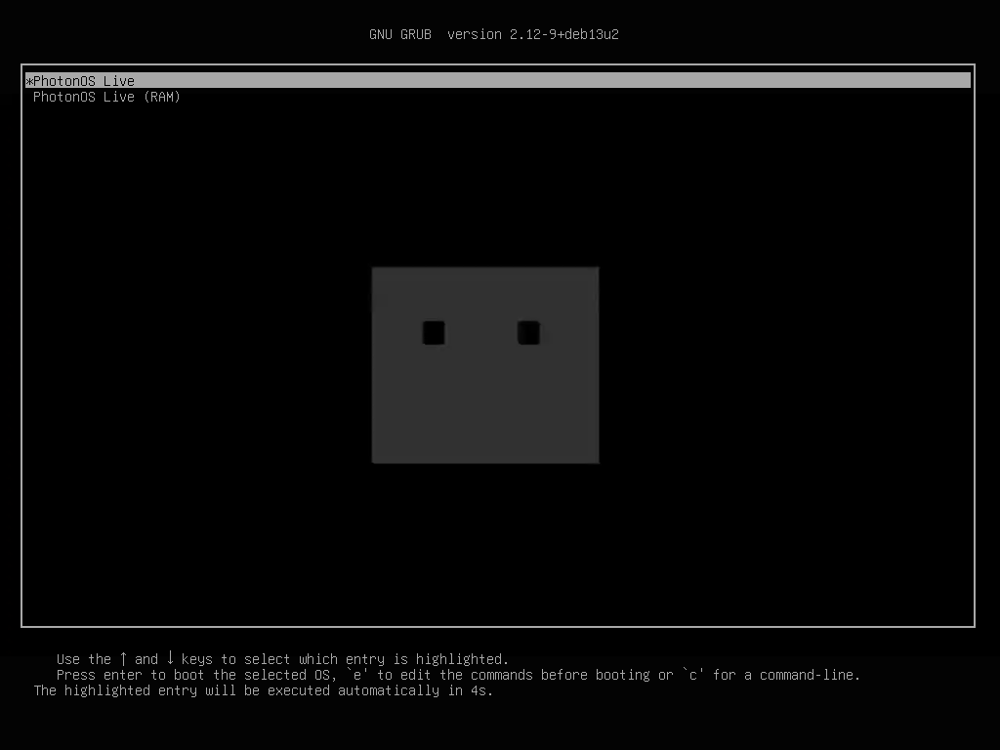

<div align="center">

# PhotonOS

```text
@@@@@@@@@@@@@@@@@@@@@@@@@@@@@@@@*
@@@@@@@@@@@@@@@@@@@@@@@@@@@@@@@@%
@@*.....@@@@@@@@@@@@@@@@.....%@@%
@@*.....@@@@@@@@@@@@@@@@.....%@@%
@@@@@@@@@@@@@@@@@@@@@@@@@@@@@@@@%
@@@@@@@@@@@@@@@@@@@@@@@@@@@@@@@@%
@@@@@@@@@@@@@@@@@@@@@@@@@@@@@@@@%
@@@@@@@@@@@@@@@@@@@@@@@@@@@@@@@@%
@@@@@@@@@@@@@@@@@@@@@@@@@@@@@@@@%
@@@@@@@@@@@@@@@@@@@@@@@@@@@@@@@@%
@@@@@@@@@@@@@@@@@@@@@@@@@@@@@@@@%
@@@@@@@@@@@@@@@@@@@@@@@@@@@@@@@@%
@@@@@@@@@@@@@@@@@@@@@@@@@@@@@@@@%
@@@@@@@@@@@@@@@@@@@@@@@@@@@@@@@@%
@@@@@@@@@@@@@@@@@@@@@@@@@@@@@@@@%
@@@@@@@@@@@@@@@@@@@@@@@@@@@@@@@@%
@@@@@@@@@@@@@@@@@@@@@@@@@@@@@@@@%
+@@@@@@@@@@@@@@@@@@@@@@@@@@@@@@@
```

**Лёгкий Linux-дистрибутив на базе Debian 13: офисные задачи и слабые ПК.**

[](https://github.com/mel0k1/PhotonOS/actions/workflows/build.yml)


[](LICENSE)

</div>

## Что внутри

- База - Debian trixie без метапакетов; документация и man вырезаны на уровне dpkg.
- Рабочий стол - LXQt 2.1 в духе Deepin: панель-док, тёмная тема Onyxian-Rounded
  с Kvantum Orchis, иконки Papirus, композитор picom (тени, блюр).
- Офис - LibreOffice Writer и Calc, просмотр PDF (qpdfview), блокнот
  FeatherPad, орфография (hunspell-ru); печать - CUPS с автообнаружением
  сетевых принтеров; почта - Claws Mail.
- photon-welcome - окно первого входа (обновления, принтеры, копия, почта);
  photon-backup - rsync-копия домашнего каталога по ежедневному таймеру.
- Для слабых ПК - zram (zstd, половина RAM) и earlyoom; для ноутбука -
  сон по закрытию крышки (logind) и энергосбережение LXQt.
- Русский UI по умолчанию, обои photon-ribbon.
- Загрузка - plymouth-тема photon-boot: чёрный квадрат с глазами собирается
  кадр за кадром.
- Брендинг - os-release, motd, issue, иконки photon, photon-fetch.

## Скриншоты

Кадры из live-образа (QEMU, LXQt 2.1 + picom, Onyxian-Rounded):




CI на каждый push собирает ISO и сразу гоняет smoke-тест: загрузка в QEMU
(BIOS и EFI/OVMF), скриншоты, телеметрия photon-diag. Последняя сборка -
в rolling-релизе [iso](https://github.com/mel0k1/PhotonOS/releases/tag/iso).
Live-сессия - автологин под `anon` без пароля.

## Состав репозитория

```text
PhotonOS/
├── build/
│   ├── build-iso.sh        # пайплайн: mmdebstrap -> squashfs -> ISO
│   └── packages.list       # пакеты live-образа (Debian trixie)
├── branding/plymouth/photon-boot/  # тема загрузки (кадры анимации)
├── overlay/                # файлы в корень образа: LXQt, обои, иконки, брендинг
├── installer/              # мастер установки (PyQt6) + бэкенд + --auto
├── welcome/                # photon-welcome: окно первого входа (PyQt6)
├── backup/photon-backup    # rsync-копия $HOME (CLI + таймер)
├── ppm/ppm                 # Photon Package Manager (обёртка над apt)
├── fetch/photon-fetch      # ASCII-сводка о системе
├── scripts/                # CI-тесты и генераторы графики
└── .github/workflows/      # CI: сборка ISO + smoke-тест
```

## Сборка

Нужен хост Debian/Ubuntu с правами root:

```sh
apt install mmdebstrap squashfs-tools xorriso mtools dosfstools
./build/build-iso.sh          # результат: dist/PhotonOS-live-amd64-<дата>.iso
```

## Автоустановка

`photon-auto.conf` в корне live-носителя + команда `photon-installer --auto`
в live-сессии - установка на весь диск без вопросов (лог в консоль):

```ini
DISK=/dev/sda
USERNAME=user
PASSWORD=change-me
FULLNAME=User
HOSTNAME=photon
TZ=Europe/Moscow
LOCALE=ru
SWAP=yes
DE=lxqt
MAIL=yes
REBOOT=yes
```

## Планы

- [ ] Установщик на диск - отладка мастера
- [x] Фирменные приложения: photon-welcome, photon-backup
- [ ] Фирменные приложения: следующий раунд
- [x] Слабые ПК: zram, earlyoom, CI-метрики RAM/ISO, автоустановка --auto
- [x] ppm: порт на apt (входит в образ)

## Лицензия

Проект распространяется по [GPL-3.0](LICENSE).
