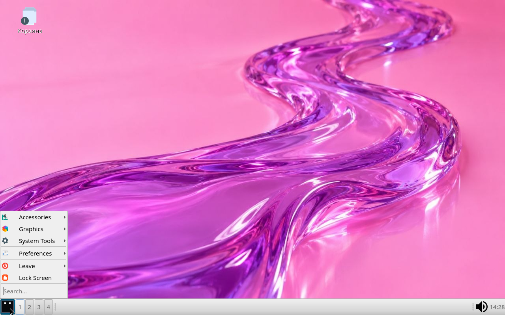
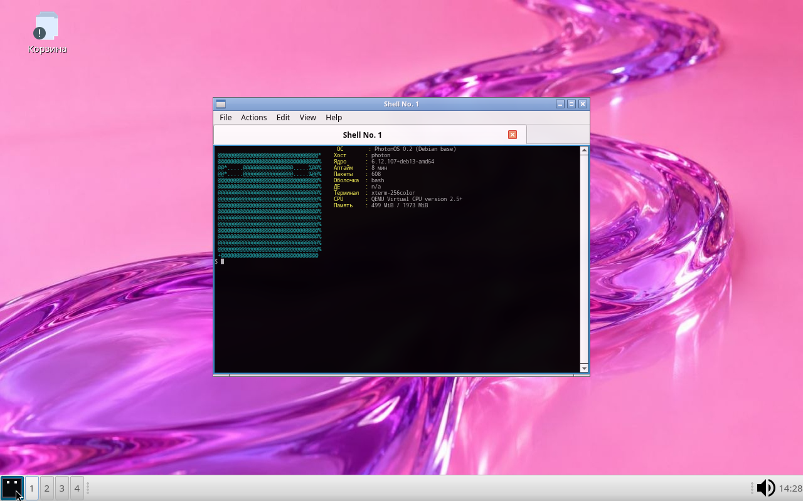

<div align="center">

# PhotonOS

```text
@@@@@@@@@@@@@@@@@@@@@@@@@@@@@@@@*
@@@@@@@@@@@@@@@@@@@@@@@@@@@@@@@@%
@@*.....@@@@@@@@@@@@@@@@.....%@@%
@@*.....@@@@@@@@@@@@@@@@.....%@@%
@@@@@@@@@@@@@@@@@@@@@@@@@@@@@@@@%
@@@@@@@@@@@@@@@@@@@@@@@@@@@@@@@@%
@@@@@@@@@@@@@@@@@@@@@@@@@@@@@@@@%
@@@@@@@@@@@@@@@@@@@@@@@@@@@@@@@@%
@@@@@@@@@@@@@@@@@@@@@@@@@@@@@@@@%
@@@@@@@@@@@@@@@@@@@@@@@@@@@@@@@@%
@@@@@@@@@@@@@@@@@@@@@@@@@@@@@@@@%
@@@@@@@@@@@@@@@@@@@@@@@@@@@@@@@@%
@@@@@@@@@@@@@@@@@@@@@@@@@@@@@@@@%
@@@@@@@@@@@@@@@@@@@@@@@@@@@@@@@@%
@@@@@@@@@@@@@@@@@@@@@@@@@@@@@@@@%
@@@@@@@@@@@@@@@@@@@@@@@@@@@@@@@@%
@@@@@@@@@@@@@@@@@@@@@@@@@@@@@@@@%
+@@@@@@@@@@@@@@@@@@@@@@@@@@@@@@@
```

**Лёгкий дистрибутив Linux на базе Debian: минимум лишнего, фирменный вид.**

[](https://github.com/mel0k1/PhotonOS/actions/workflows/build.yml)


[](LICENSE)

</div>

## О проекте

PhotonOS — независимый дистрибутив-/live-образ, собранный на **минимальном
Debian**: только база, наш рабочий стол и наш брендинг — без мусора.

Основные решения:

- **База** — Debian trixie, стабильные пакеты, предсказуемые обновления.
- **Минимум** — LXQt-ядро без метапакетов, без офиса и прочего лишнего;
  документация и man-страницы вырезаны на уровне dpkg.
- **Рабочий стол** — **LXQt в духе Deepin**: нижняя панель-док, светлые темы
  (Arc + Papirus), композитор **picom** с тенями и блюром, фирменные обои.
- **Загрузка** — фирменная plymouth-тема **photon-boot**: чёрный квадрат
  с двумя белыми глазами собирается из кадра за кадром.
- **Брендинг** — os-release, motd, issue, иконки photon, photon-fetch.

История: раньше проект собирался на базе Void Linux (glibc + runit + XBPS,
шаблоны DDE и Hyprland-стека) — эта линия закрыта, вся обвязка удалена;
в git-истории осталась.

## Скриншоты

Кадры из live-образа (QEMU, Debian trixie, LXQt 2.1 + picom):


| Меню приложений | photon-fetch в qterminal |
| --- | --- |
|  |  |

## Состав репозитория

```text
PhotonOS/
├── build/
│   ├── build-iso.sh        # пайплайн: mmdebstrap -> squashfs -> ISO
│   └── packages.list       # пакеты live-образа (Debian trixie)
├── branding/
│   └── plymouth/photon-boot/  # тема загрузки (кадры анимации)
├── overlay/                # файлы, попадающие в корень образа
│   ├── etc/motd, issue, photon/picom.conf, plymouth/plymouthd.conf
│   ├── etc/skel/           # дефолты LXQt в стиле Deepin + Корзина
│   ├── usr/share/backgrounds/  # фирменные обои
│   ├── usr/share/icons/photon/ # фирменные иконки (24-256)
│   └── usr/lib/os-release  # брендинг системы
├── ppm/ppm                 # Photon Package Manager (обёртка, порт с XBPS)
├── fetch/photon-fetch      # ASCII-сводка о системе
├── logo/photon.txt         # ASCII-логотип
├── scripts/                # генераторы обоев/иконок
└── .github/workflows/      # CI: ISO на push в main
```

## Сборка ISO

Нужен хост Debian/Ubuntu с правами root (CI делает всё сам):

```sh
apt install mmdebstrap squashfs-tools xorriso mtools dosfstools
./build/build-iso.sh          # результат: dist/PhotonOS-live-amd64-<дата>.iso
```

CI собирает ISO на каждый push в `main` — образ доступен артефактом сборки
(вкладка Actions). Загрузка: BIOS (isolinux) и EFI (grub), live-пользователь
`user` с паролем `live` (стандарт Debian live).

## Сборка из исходников — планы

- [x] Перевод на базу Debian, минимизация
- [x] Фирменная загрузка photon-boot и логотип
- [x] LXQt в духе Deepin
- [ ] ppm: порт с XBPS на apt
- [ ] Установщик на диск (порт с Void-версии)
- [ ] Фирменные приложения

## Лицензия

Проект распространяется по [GPL-3.0](LICENSE).
